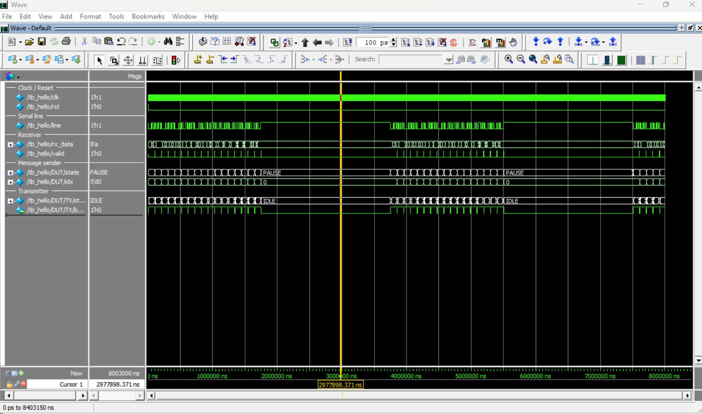
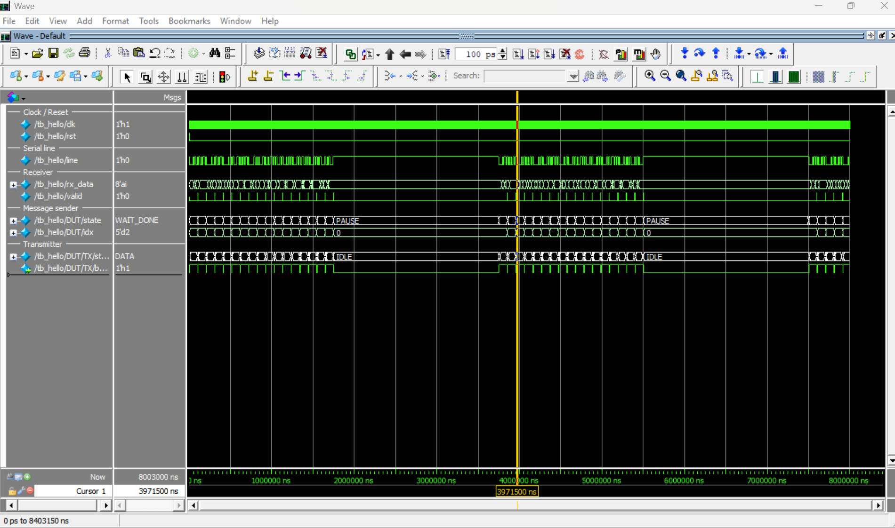
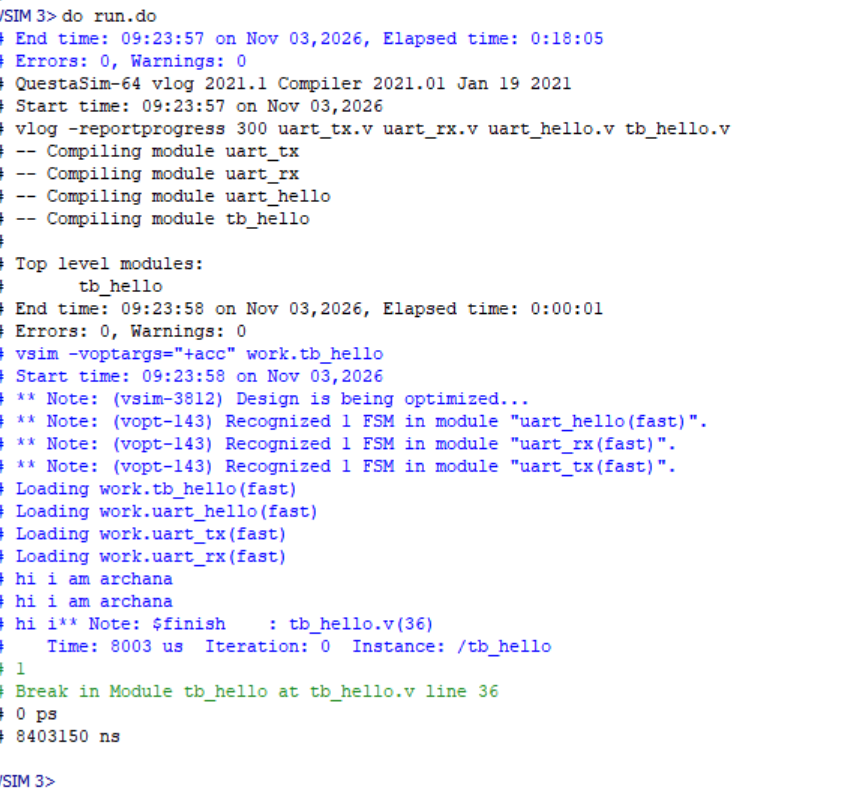

# UART Transmitter and Receiver in Verilog

A basic UART (8N1) written in Verilog using finite state machines. A small
message-sender FSM feeds characters to the transmitter, so the design
continuously sends `hi i am archana` followed by a line break.

Implemented and verified in simulation (QuestaSim) with a loopback testbench
in which the receiver decodes what the transmitter sends.

## Features

- 8 data bits, no parity, 1 stop bit (8N1), LSB first
- Baud rate set by parameters (`CLK_FREQ`, `BAUD`)
- Receiver samples in the middle of each bit
- 2-flip-flop synchronizer on the receiver input
- Handshake (`start` / `busy`) between the sender and the transmitter

## Files

| File | Description |
|---|---|
| `uart_tx.v` | UART transmitter (4-state FSM) |
| `uart_rx.v` | UART receiver (4-state FSM) |
| `uart_hello.v` | Sends the message one character at a time |
| `tb_hello.v` | Loopback testbench (TX -> RX, prints received text) |
| `run.do` | QuestaSim script (compile, add waves, run) |

## Frame format

```
idle  START  D0 D1 D2 D3 D4 D5 D6 D7  STOP  idle
 1      0    LSB ...............MSB     1     1
```

Each bit lasts `CLKS_PER_BIT = CLK_FREQ / BAUD` clock cycles
(5208 for 50 MHz at 9600 baud).

## Design overview

```
 uart_hello (message FSM) --start, data--> uart_tx --tx--> line --> uart_rx --> data, valid
                          <----busy------
```

Transmitter FSM: `IDLE -> START -> DATA (x8) -> STOP -> IDLE`

Message sender FSM: `LOAD -> WAIT_BUSY -> WAIT_DONE -> (next char) ... -> PAUSE`

## Block descriptions

### `uart_tx.v` - Transmitter

Converts one parallel byte into a serial bit stream on a single wire.

- **Inputs:** `clk`, `rst`, `start` (1-clock pulse), `data[7:0]`
- **Outputs:** `tx` (serial line, idles high), `busy` (high while sending)
- **How it works:** a 4-state FSM (`IDLE -> START -> DATA -> STOP`). When `start`
  arrives it copies `data` into an internal `shift` register, sends a low
  start bit, then the 8 data bits LSB first (`shift[bit_idx]`), then a high stop bit.
- **Baud timing:** a counter `clk_cnt` counts `CLKS_PER_BIT` clock cycles per bit.

### `uart_rx.v` - Receiver

Rebuilds a byte from the serial line.

- **Inputs:** `clk`, `rst`, `rx`
- **Outputs:** `data[7:0]` (received byte), `valid` (1-clock pulse when a byte is ready)
- **How it works:** a 4-state FSM. It waits for the falling edge of the start
  bit, waits half a bit time and checks the line is still low (rejects glitches),
  then samples every full bit time in the middle of each bit and stores it in `data`.
- **Synchronizer:** `rx` passes through two flip-flops first, because it is
  asynchronous to the receiver's clock.

### `uart_hello.v` - Message sender

Feeds the message `hi i am archana` to the transmitter one character at a time.

- **Inputs:** `clk`, `rst`
- **Output:** `tx` (connected to the transmitter inside)
- **How it works:** a 4-state FSM (`LOAD -> WAIT_BUSY -> WAIT_DONE -> PAUSE`).
  It puts the next character on `data`, pulses `start`, waits for `busy` to go
  high and then low (character finished), and repeats. After the last character
  (followed by carriage return and line feed) it pauses for `PAUSE_CLKS` clocks
  and starts the message again.
- **Contains:** one instance of `uart_tx`.

### `tb_hello.v` - Testbench

Checks the design in simulation without any hardware.

- Generates the clock and reset.
- Instantiates `uart_hello` (sender plus transmitter) and `uart_rx`, with the
  transmitter output connected straight to the receiver input (loopback).
- Prints every received character in the transcript, so you can see the
  message come back.
- Uses scaled-down parameters (1 MHz clock, 100000 baud) so the simulation is quick.

### `run.do` - QuestaSim script

Compiles the files, starts the simulation, adds the waveforms (clock, reset,
serial line, received data, sender and transmitter states with readable names)
and runs it.

## Run the simulation (QuestaSim)

1. Open QuestaSim and change directory to this folder.
2. In the transcript window run:

```
do run.do
```

Expected transcript output:

```
hi i am archana
hi i am archana
hi i
```

The last line is cut short because the testbench stops at 8 ms, in the middle
of the third message.

The testbench uses scaled-down values (1 MHz clock, 100000 baud) so the
simulation finishes quickly. The logic is the same as the real design.

## Simulation output

### How to read the waveform

| Signal | What it shows |
|---|---|
| `line` | The serial wire. High when idle, low for the start bit, then the data bits |
| `rx_data` | The byte rebuilt by the receiver (ASCII letters) |
| `valid` | A short pulse each time the receiver finishes one character |
| `DUT/state` | Message sender state: LOAD, WAIT_BUSY, WAIT_DONE, PAUSE |
| `DUT/idx` | Number of the character being sent (0 to 16) |
| `DUT/TX/state` | Transmitter state: IDLE, START, DATA, STOP |
| `busy` | High while the transmitter is sending a character |

In the screenshots, each dense burst on `line` is one full message (15 letters
plus carriage return and line feed). The flat gap between bursts is the pause.

### 1. Pause between messages



The cursor is in the gap between two messages. `line` is high (idle),
`DUT/state` is PAUSE, `DUT/TX/state` is IDLE, `busy` is 0, and `idx` is back
at 0. `rx_data` still holds the last byte received, 0x0A (line feed).

### 2. While a message is being sent



The cursor is in the middle of a message. `DUT/state` is WAIT_DONE (waiting for
the character to finish), `DUT/TX/state` is DATA (sending a data bit), `busy` is 1,
and `idx` is 2. `rx_data` shows `i`, the last character the receiver finished.

### 3. Transcript



Both files compile with 0 errors and 0 warnings, and the receiver prints the
message. The last line is cut short because the simulation stops at 8 ms.

### What one character looks like on the line

The first character `h` is 0x68 = `01101000`. It is sent LSB first, and each bit
lasts 10 us (10 clock cycles at 1 MHz and 100000 baud):

```
idle  START  D0 D1 D2 D3 D4 D5 D6 D7  STOP  idle
 1      0    0  0  0  1  0  1  1  0    1      1
```

## Limitations and possible improvements

- No parity bit and no framing-error check on the stop bit
- Receiver samples once per bit (no 16x oversampling)
- No FIFO buffering
- Testbench prints output instead of checking it automatically
- Verified in simulation only
